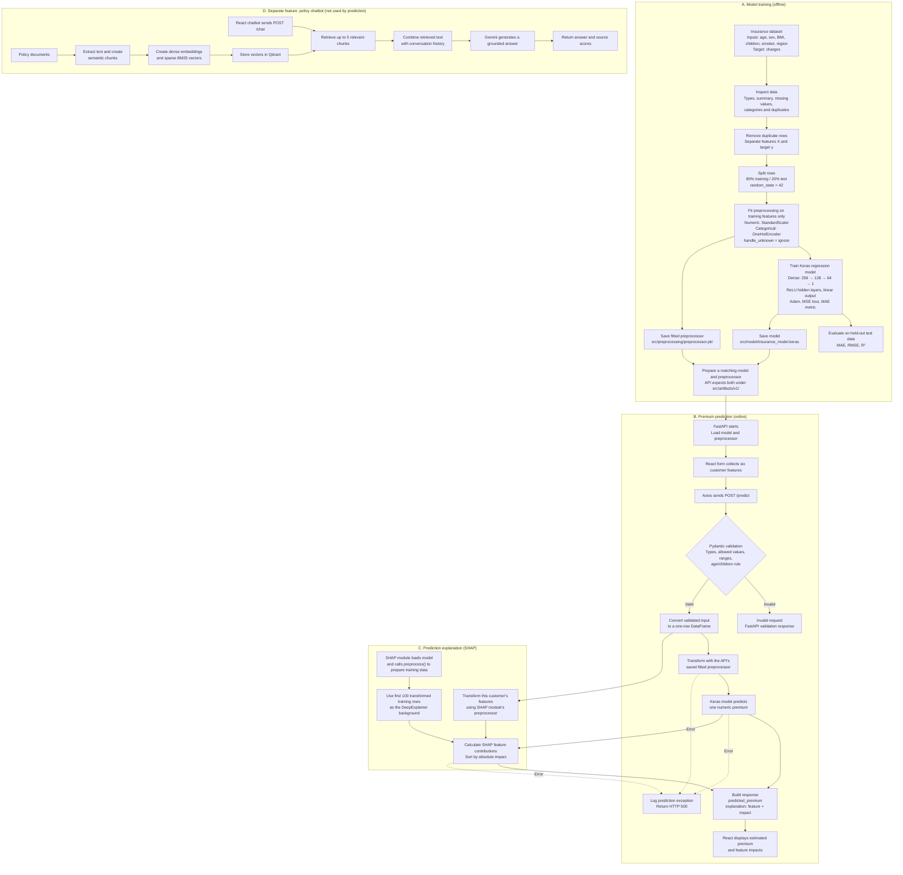

# TrustInsure AI: Prediction Flow and Interview Guide

This guide describes the current project in simple technical language. The
flowchart is a Mermaid diagram, not an image. It covers model training,
prediction, explanations, and the separate policy chatbot.

## End-to-end flow diagram

## What the project does

The project has two separate features:

- **Premium prediction** estimates a numeric `charges` value from six customer
  features. This is a supervised regression problem.
- **Policy chatbot** searches insurance documents and generates answers from
  the retrieved text. It does not calculate the predicted premium.

## Why this design, and what are the alternatives?

| Choice in this project | Why it fits | Alternative to consider |
|---|---|---|
| Regression | The target, `charges`, is a number. | Classification would predict a premium band, not an amount. |
| StandardScaler for numeric features | Puts age, BMI, and children on comparable scales for neural-network training. | Tree models often do not need scaling. RobustScaler is worth testing if outliers distort the scale. |
| OneHotEncoder for categories | Encodes sex, smoker, and region without making them look like ordered numbers. | CatBoost or another model with native categorical support. |
| Dense neural network | The implemented model can learn nonlinear relationships between encoded features. | Linear/Ridge is a useful simple baseline. Random Forest or gradient boosting are important tabular-data comparisons. |
| MAE, RMSE, and R² | MAE and RMSE measure prediction error in target units; R² compares performance with a mean-target baseline. | Choose a primary business metric after agreeing how over- and under-prediction costs differ. |
| SHAP explanations | Gives feature contributions for an individual prediction. | Other attribution methods or a global feature-importance summary. None establishes causation. |
| RAG chatbot | Retrieves relevant policy passages before generating an answer, keeping document Q&A separate from numeric prediction. | A plain LLM prompt lacks retrieved policy evidence; fine-tuning alone is not a substitute for retrieving current policy text. |

The neural network is the model implemented in this project. The repository
does not include measured comparisons with linear or tree-based models, so it
does not establish that the neural network is the best choice. Compare
candidate models on the same data split and metrics before making that claim.

## How prediction works

1. **Inspect and clean data.** The preprocessing code reads the insurance
   dataset, removes duplicate rows, and separates input features from
   `charges`.
2. **Split the data.** It reserves 20% for testing and uses the other 80% for
   training and validation.
3. **Encode the inputs.** `StandardScaler` transforms numeric columns.
   `OneHotEncoder` transforms categorical columns. The preprocessor is fitted
   on training data, then reused to transform test data.
4. **Train the model.** The Keras network has three ReLU hidden layers
   (256, 128, and 64 units) and one linear output. Training uses Adam with
   learning rate 0.001, MSE loss, MAE metric, batch size 32, and up to 100
   epochs. Keras uses 20% of the training data for validation.
5. **Evaluate.** The model predicts on the held-out test data. The training
   script reports MAE, RMSE, and R².
6. **Accept a request.** React sends age, sex, BMI, children, smoker, and
   region to FastAPI at `POST /predict`.
7. **Validate and transform.** Pydantic checks input types, allowed values,
   ranges, and the rule that a customer under 18 cannot have children. The
   API turns valid input into a one-row DataFrame and applies its loaded
   preprocessor.
8. **Predict and explain.** Keras returns one number. The SHAP module computes
   feature contributions and orders them by absolute impact.
9. **Return and display.** The API returns `predicted_premium` and an
   `explanation` list. React displays the result and its feature impacts.

## Interview questions and follow-ups

### Project and data

**What problem does the model solve?**  
It estimates an insurance charge from customer features. The target is
numeric, so the problem is regression.

**What are the inputs and target?**  
Inputs are age, sex, BMI, children, smoker, and region. The target is
`charges`.

**Why remove duplicate rows?**  
Repeated records can give the same examples extra weight during training.
Deduplication reduces that risk. It is still important to check whether
repeated rows are true duplicates or valid separate records.

**How would you handle missing data?**  
First measure and understand the missingness. Then choose an explicit
imputation or record-removal strategy and fit any imputer on training data
only. The current training pipeline does not implement a missing-value
imputer.

**What is data leakage, and how do you avoid it?**  
Leakage occurs when training or model selection uses information that would
not be available at prediction time. The code splits the rows before fitting
the scaler and encoder, and fits them only on training features. Test data is
transformed, not used to fit those steps.

**Follow-up: Is validation data the same as test data?**  
No. The 20% test split is held out for evaluation. Keras takes a validation
subset from the training split during fitting. The test set should not guide
training or model selection.

### Model and evaluation

**Why use a regression model?**  
The application needs an estimated number. Classification would be suitable
if the requirement were instead to assign a label such as low, medium, or
high.

**Why scale numeric features?**  
Age, BMI, and children have different scales. Scaling helps gradient-based
training by making their magnitudes more comparable. Tree-based models often
do not need this step.

**Why use one-hot encoding?**  
Sex, smoking status, and region are categories without a meaningful numeric
order. One-hot encoding represents each category without assigning one an
artificial higher or lower rank.

**Why use a neural network?**  
It is the model implemented here and can learn nonlinear feature
relationships. It is not proven to be the best model for this dataset:
the project does not record a baseline comparison.

**Follow-up: What would you compare it against?**  
Start with Linear Regression or Ridge as a simple baseline. Also test a
Random Forest and a gradient-boosted model such as CatBoost. Compare them
using the same split, inputs, and metrics.

**What do MAE, RMSE, and R² tell you?**  
MAE is average absolute error. RMSE is also an error in target units, but
penalizes large errors more heavily. R² measures performance relative to
predicting the mean target; it can be negative when predictions are poor.

**Which metric should decide the winner?**  
Agree on the main metric based on the business cost of under- and
over-prediction. Also review secondary metrics and errors across important
customer groups. The repository does not contain verified metric results, so
do not quote numbers without running evaluation.

**Is early stopping enabled?**  
No. The code creates an `EarlyStopping` callback but does not pass it to
`model.fit`. Training can run for all 100 epochs.

### API and explanations

**What happens when the user requests a prediction?**  
React sends the form data to `POST /predict`. FastAPI validates it, transforms
the features, asks the loaded model for one estimate, generates SHAP impacts,
and returns both in JSON.

**What input validation is present?**  
Age must be greater than 0 and no more than 100. BMI must be greater than 0
and no more than 100. Children must be between 0 and 10. Sex, smoker, and
region have allowed values. A customer younger than 18 cannot have children.

**What happens when input is invalid or prediction fails?**  
Invalid input is rejected by FastAPI/Pydantic before inference. An exception
inside prediction is logged and returned as HTTP 500. React displays an
error state when the request fails.

**Why load the model at startup?**  
It avoids loading the model on every request and allows reuse across
predictions. The trade-off is that a new model needs a controlled reload or
service restart.

**What does SHAP explain?**  
SHAP provides feature contribution values for a particular model prediction
relative to the explainer's background. These values explain model behavior;
they do not show that a feature caused a change in the real world.

**Follow-up: Does SHAP explain the prediction using the exact API preprocessor?**  
Not in the current code. The API loads a preprocessor from
`src/artifacts/v1/`, while the SHAP module calls `preprocess()` and fits a
separate transformer from the training dataset. They may produce the same
encoding, but that is not guaranteed. A production improvement is to make
SHAP use the exact versioned preprocessor and background data for the served
model.

### System design and improvement

**What is the current artifact-path issue?**  
Training saves the model under `src/model/` and the preprocessor under
`src/preprocessing/`. The API loads both from `src/artifacts/v1/`. Deployment
must place a matching model and preprocessor in the paths used by the API.

**What would you improve before production?**  
Version and deploy the model with its matching preprocessor. Make SHAP use
that same preprocessor. Compare the neural network against simple and
tree-based baselines. Add automated tests, input/data-quality monitoring,
and model-performance monitoring when actual labels become available.

**Does the prediction code convert currency?**  
No currency conversion is visible in the API or model code. The UI displays
a `₹` symbol, so verify that the training target is in the matching currency
and units before presenting it as an INR estimate.

**How does the chatbot work?**  
Policy text is extracted, split into chunks, represented as dense embeddings
and sparse BM25 vectors, and stored in Qdrant. For a question, the chatbot
retrieves up to five relevant chunks, includes them with the conversation
history in a prompt, and asks Gemini to answer. It returns the answer and
source scores.

**Follow-up: Does the chatbot generate the premium?**  
No. The chatbot answers policy questions from retrieved documents. The
separate regression model predicts the numeric amount.

## Important facts to verify before an interview

- Run evaluation and record the actual MAE, RMSE, and R². The code alone does
  not establish metric values.
- Do not claim the neural network is the best model until it has been
  compared with baselines on a consistent evaluation.
- Confirm the currency and units of the `charges` target; the UI displays
  `₹`, but the model code does not convert currencies.
- Confirm that the API's model and preprocessor files exist under
  `src/artifacts/v1/` and come from the same training run.
- Remember that SHAP currently refits a separate preprocessor and requires
  the training dataset during module initialization.
- Remember that the `EarlyStopping` callback is not currently used.

## Short interview summary

> TrustInsure AI estimates a numeric insurance charge using a regression
> model. The training pipeline splits the data, fits scaling and categorical
> encoding on training rows, trains a Keras neural network, and evaluates it
> with MAE, RMSE, and R². The API validates each request, applies its saved
> preprocessor, predicts an amount, and returns SHAP feature contributions.
> A separate RAG chatbot retrieves policy text to answer insurance questions.
> Before production, I would compare model baselines, align model and
> preprocessor versions, make SHAP use the deployed preprocessor, and verify
> the target currency.
